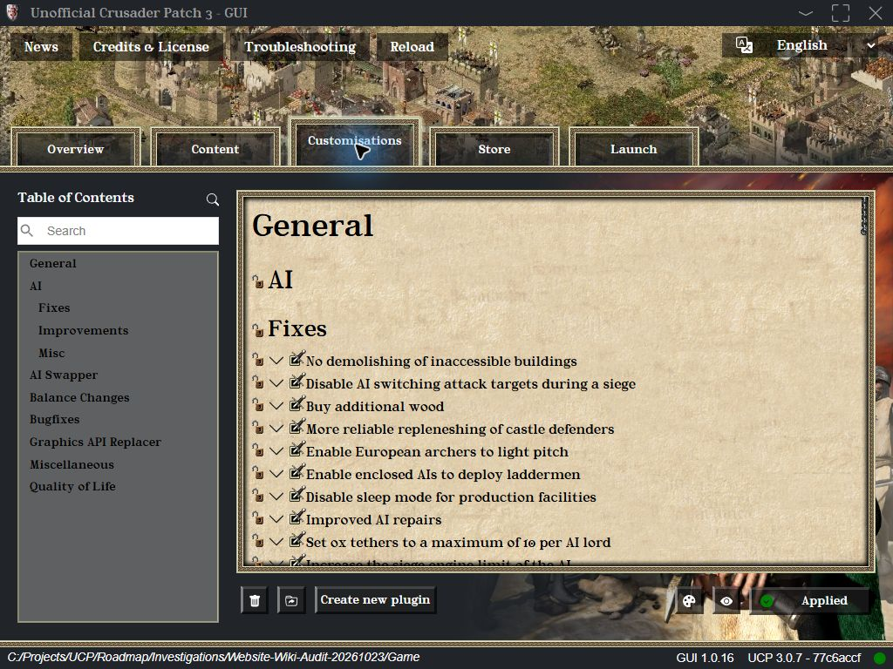
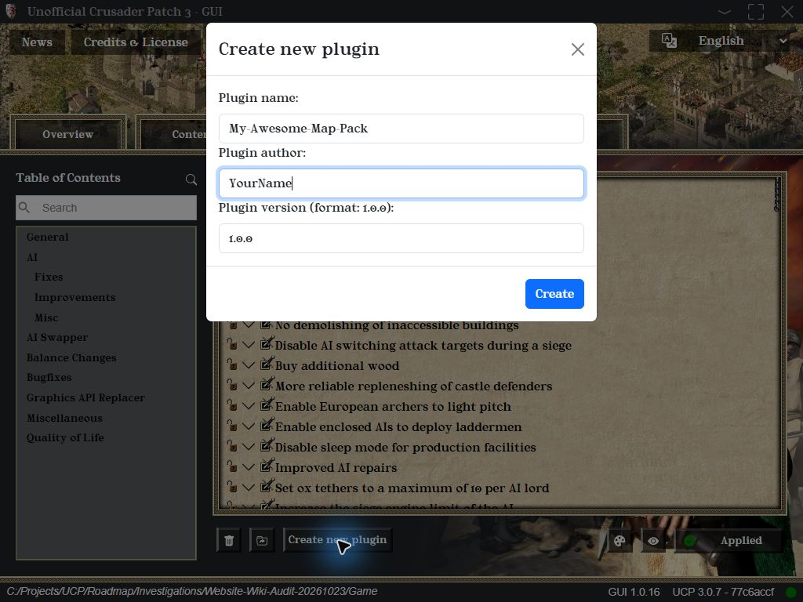

# Creating a Plugin

Plugins are the primary way to add new content to Stronghold Crusader with UCP. This guide will walk you through the creation of a basic plugin.

## Step 1: Use the GUI to Create a Template

1.  Activate the extensions you need under **Content** and set their options under **Customisations**.
2.  In **Customisations**, click the palette icon at the bottom right to enable **Creator mode**.
3.  Click **Create new plugin** at the bottom left.
4.  Enter a **Plugin name** using letters, numbers and hyphens (e.g., `My-Awesome-Map-Pack`), your **Plugin author** name, and a **Plugin version** (e.g., `1.0.0`).
5.  Click **Create**, then **Ok** when asked to reload.





The GUI saves your current configuration and dependencies as `config.yml` and `definition.yml` in `ucp/plugins/<Name>-<Version>/`. Add your custom content to that folder next.

## Step 2: Understand the `definition.yml`

Open the newly created `definition.yml` file in a text editor. This file is the identity card of your plugin.

```yaml
name: "My-Awesome-Map-Pack"
display-name: "My Awesome Map Pack"
version: "1.0.0"
author: "YourName"
description: "A collection of symmetrical maps for multiplayer."
type: plugin
meta:
  version: 1.0.0
# If your plugin relies on another extension (e.g., the AI Swapper),
# you would list it as a dependency here.
dependencies:
  aiSwapper: ^1.1.0
  framework: ^3.0.0
  frontend: ^1.0.0
```

## Step 3: Add Your Content to the `resources` Folder

Create a `resources` subfolder for your content. Include and configure the loaders your plugin needs.

* **For Custom Maps:** Place your `.map` files in `resources/maps/`.
* **For Custom AI:** Follow the structure outlined in the [AI Editing Tutorial](../../Stronghold-Crusader-Wiki/AI-Lords/AI-Editing-Tutorial.md). Place your AI folders in `resources/ai/`.

## Step 4: Adding User Options (Optional)

If you want users to be able to configure your plugin, you can create an `options.yml` file. See the [Configuration](Configuration.md) guide for details.

## Step 5: Activate and Test

After adding your files, click **Reload** in the GUI. Under **Content**, find your plugin in **Available extensions**, click its right-pointing arrow to move it to **Activated extensions**, then click **Apply**. Launch the game and test if your new content appears correctly.
